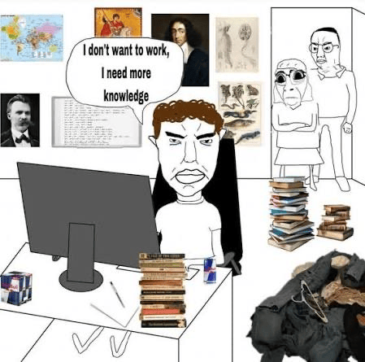

# [qa](https://telingc.github.io/qa/)

### About

Just my simple learning log.

Sometimes a small question takes me through a few pages of calculations
and a Python plot, only to leave me with another question.
I thought I should keep these somewhere.
Some notes are unfinished. Some are probably wrong. But that's part of why they're here 🤭.

Mostly physics and mathematics for now. Hope you find something interesting 😊.

### FAQ

**Q: What does "qa" stand for?**

A: *Quiet Atlas*, not *Questions & Answers*. Though there are plenty of questions.

**Q: Why publish unfinished notes?**

A: Writing things down helps me find the gaps. Leaving them open might help someone else find a few more.

**Q: What if I find something wrong?**

A: Leave a comment under the note, or email me! 
Even “wait, why?” is useful. Thanks 😊!

**Q: Can I use this?**

A: As you like! And I'll try to make this repo easier for you to deploy as much as I can.

**Q: Wait, This sounds really dumb.**

A: I agree. 🤣