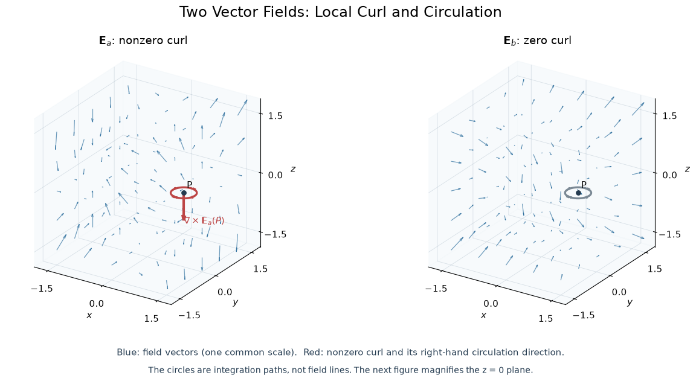
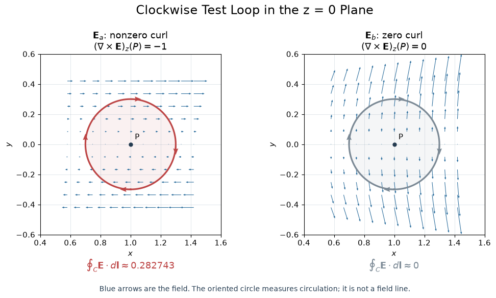

## Admissible field and potential
Consider the following Cartesian vector fields, with $k$ constant and carrying the appropriate units:$$\begin{aligned}
\mathbf E_a&=k\bigl(xy\,\hat{\mathbf x}+2yz\,\hat{\mathbf y}+3xz\,\hat{\mathbf z}\bigr),\\
\mathbf E_b&=k\bigl[y^2\,\hat{\mathbf x}+(2xy+z^2)\,\hat{\mathbf y}+2yz\,\hat{\mathbf z}\bigr].
\end{aligned}$$
1. Identify which field cannot be electrostatic, and justify the conclusion.
2. For the admissible field, obtain the potential with $V(0,0,0)=0$.
### 1. Admissibility
To calculate the curl of the electrostatic field, we use the determinant expression of the curl:$$\nabla\times\mathbf{E}=\left|
\begin{array}{ccc}
\hat{\mathbf{x}} & \hat{\mathbf{y}} & \hat{\mathbf{z}} \\
\frac{\partial}{\partial x} & \frac{\partial}{\partial y} & \frac{\partial}{\partial z} \\
\mathbf{E}_x & \mathbf{E}_y & \mathbf{E}_z
\end{array}
\right|$$The answer we got is $\displaystyle \nabla\times\mathbf{E}_a=-k(2y\hat{\mathbf x}+3z\hat{\mathbf y}+x\hat{\mathbf z})$, obviously that the curl isn't $\mathbf{0}$ for most cases, thus the first field is not admissible. Similarly we can examine the admissibility of the second field expression. The answer is $$\nabla\times\mathbf{E}_b=\mathbf 0$$which satisfies the conditions for a electrostatic field perfectly.
### 2. Potential
From the potential's definition$$\mathbf E=-\nabla V$$we can have the differential equations, integrate them and get the answer easily$$\begin{align*}-\frac{\partial V}{\partial x}&=ky^2\\-\frac{\partial V}{\partial y}&=k(2xy+z^2)\\-\frac{\partial V}{\partial z}&=2kyz\\V(\mathbf 0)&=0\end{align*}\quad\Longrightarrow\quad V=-k(xy^2+yz^2)$$
## Book Hint & Integration Path
> Book hint, restated: specify a definite integration path from the origin to $(x,y,z)$. Path independence permits a convenient choice, but it does not remove the need to specify one.

We don't have to, but if it's necessary, the main steps would be quite similar with the part 2 of the example.
## Visualization
```python
from vector_field_curl_visualization import *

fields = [
    (field_a, r"$\mathbf{E}_a$: nonzero curl"),
    (field_b, r"$\mathbf{E}_b$: zero curl"),
]

points = [
    (1, 0, 0),
    (1, 1, 1),
]

for func, label in fields:
    print(label)
    examine_curl(func, points)

style = {
    "field": "#286b9b",
    "curl": "#bd4545",
    "font_size": 11,
}

fig_3d, axes_3d = visualize_vector_fields(
    fields,
    center=(1, 0, 0),
    loop_radius=0.3,
    style=style,
)

fig_xy, axes_xy = visualize_xy_circulation(
    fields,
    center=(1, 0, 0),
    loop_radius=0.3,
    normal_sign=-1,
    style=style,
)

plt.show()
```


## Source
Griffiths, *Introduction to Electrodynamics*, 4th edition (2013), Problem 2.20, printed p. 80 (PDF p. 99). Faithful paraphrase of the original tasks; any extension is marked optional.
