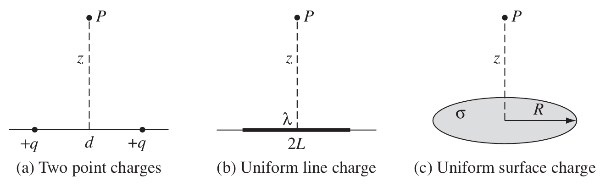

> This note is some how boring to me, if you mind just skip. :)
## Questions
The observation point is $P=(0,0,z)$ with $z>0$. Figure below describes these three configurations, stated here in coordinates:

- (a) Two point charges $+q$ at $(-d/2,0,0)$ and $(d/2,0,0)$; their separation is $d$.
- (b) A straight segment from $x=-L$ to $x=L$ on the $x$ axis, with uniform line charge density $\lambda$.
- (c) A disk in the $xy$ plane, centered at the origin, of radius $R$ and uniform surface charge density $\sigma$.
1. With $V(\infty)=0$, find the potential at $P$ for each distribution using the point-charge sum or the line/surface source integral.
2. Change only the right-hand point charge, at $(d/2,0,0)$, to $-q$. Find the potential at $P$, and say what field that axis-restricted potential might suggest. Compare with the direct vector field in Problem 2.2 and explain any apparent discrepancy carefully.
### 1. Three Source Potentials
1. **Point charges:** For point charges, use summation:$$\begin{align*}V(\mathbf r)&=\frac{1}{4\pi\epsilon_0}\sum_{i=1}^2\frac{q_i}{|\mathbf r-\mathbf r_i|}\\&=\frac{q}{2\pi\epsilon_0\sqrt{z^2+(d/2)^2}}\end{align*}$$
2. **Line charge:** Calculating the differentiate first is a clearer way of solving for me, and that goes $dq=\lambda dx$, thus$$\begin{align*}V(\mathbf r)&=\frac{1}{4\pi\epsilon_0}\int\frac{dq}{|\mathbf r-\mathbf r'|}\\&=\frac{\lambda}{4\pi\epsilon_0}\int_{-L}^L\frac{dx}{\sqrt{z^2+x^2}}\\&=\frac{\lambda}{2\pi\epsilon_0}\ln{\frac{L+\sqrt{L^2+z^2}}{z}},\quad L=\frac{d}{2}\end{align*}$$
3. **Disk charge:** Using polar coordinates is much easier than x-y coordinates $dq=r'd\theta dr'$, thus we have$$V(z)=\frac{\sigma}{4\pi\epsilon_0} \int_0^R\int_0^{2\pi} \frac{r'}{\sqrt{z^2+r'^2}}\,d\theta\,dr'=\frac{\sigma}{2\epsilon_0}\big(\sqrt{z^2+R^2}-z\big)$$
And then we can check the gradient of the potential using $\mathbf{E}=-\nabla V$.
### 2. Dipole
For now we're pausing the topic, reserving the topic of dipole for future discussions.
## Source
Griffiths, *Introduction to Electrodynamics*, 4th edition (2013), Problem 2.25, printed p. 87 (PDF p. 106). Faithful paraphrase of the original tasks; any extension is marked optional.