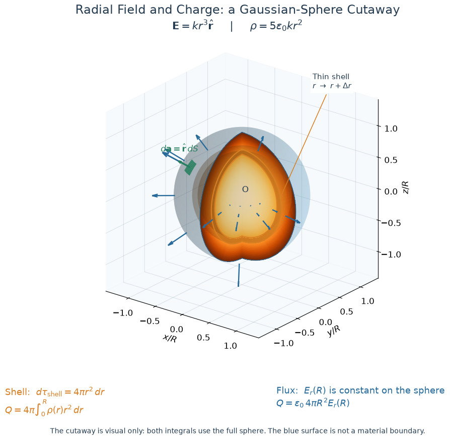

## Question
In a region containing the origin, the electric field is given in spherical coordinates by $\displaystyle \mathbf E(r)=kr^3\hat{\mathbf r}$ where $k$ is a constant with suitable units. A sphere of radius $R$ centered at the origin lies entirely in this region.
1. Determine the volume charge density $\rho$ producing this field.
2. Find the total charge inside the sphere in two independent ways: from the density and from the field flux.
### 1. Charge density
Using the divergence of the electric fields is the core idea$$\nabla\cdot\mathbf E=\frac{\rho}{\epsilon_0},\quad\mathbf E(r)=kr^3\hat{\mathbf r}$$Then we can get the density function $\rho(r,\theta)$ by calculating the divergence of the field. Since it's trivial, the answer is$$\rho(r)=5k\epsilon_0r^2$$If the coefficient you have is $4$, you may calculating the 2-dimensional version.
### 2. Enclosed Charge
Without a graph or something, we're exploring the dark with no torch. What does the region looks like actually? That's the key point. Here we're demonstrating the 3-dimensional version drawn in Jupyter ([script](../scripts/Examples/radial_field_visualization.py)).

#### 1) From Charge Density
From above discussion we have the volume density $\displaystyle \rho(r)=5k\epsilon_0r^2$, then the integral$$\begin{align*}Q_{enc}&=\int_\mathcal B\rho\cdot d\,\tau\\&=\int_0^R\int_0^{2\pi}\int_0^{\pi}5k\epsilon_0r^2\cdot r^2\sin\theta\cdot d\theta\,d\phi\,dr\\&=4\pi\epsilon_0kR^5\end{align*}$$
#### 2) From the Field Flux
Using Gauss' law $\displaystyle \oint_{\partial \mathcal V}\mathbf E\cdot d\,\mathbf a=\frac{Q_{enc}}{\epsilon_0}$, we can calculate the total charge in the region:$$
\begin{align*}Q_{enc}&=\epsilon_0\oint_\mathcal{\partial B}\mathbf{E}\cdot d\,\mathbf{a}\\&=\epsilon_0kR^3\oint_{\partial\mathcal{B}}dS\\&=4\pi\epsilon_0kR^5\end{align*}
$$And its result is completely the same with the charge density approach we used above.
## Source
Griffiths, *Introduction to Electrodynamics*, 4th edition (2013), Problem 2.9, printed p. 70 (PDF p. 89). Faithful paraphrase of the original tasks; any extension is marked optional.
