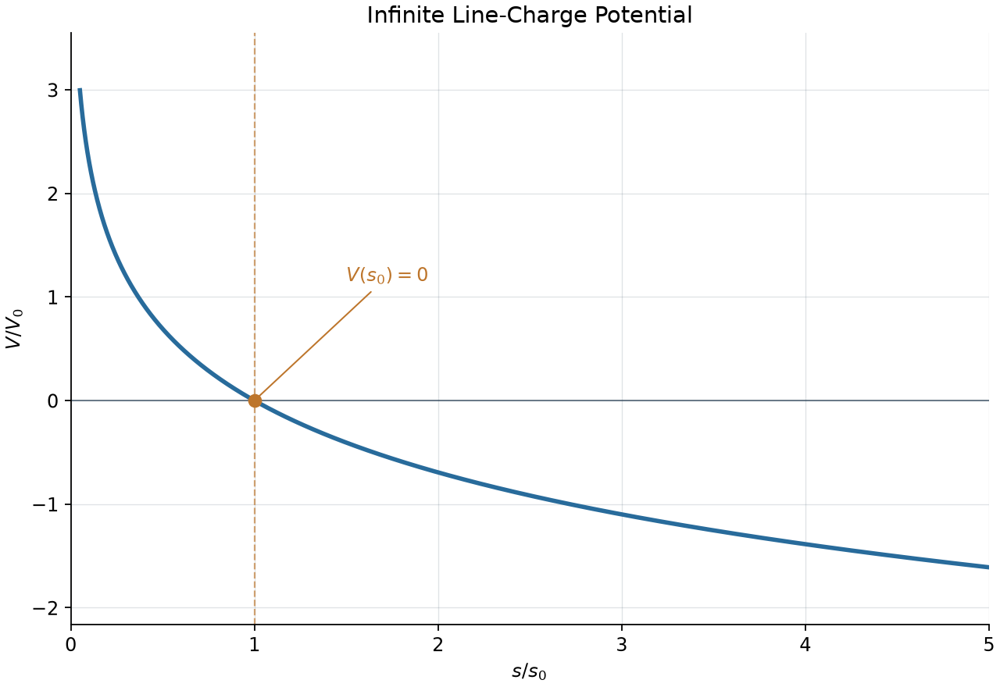

The key questions for this note is:
> 1. *Can infinity be used as a finite zero of potential for this infinite source?*
> 2. *What remains measurable if that reference cannot be used?*


## Question
An infinitely long straight wire along the $z$ axis carries uniform line charge density $\lambda$. Let $s>0$ be the perpendicular distance from the wire.
1. Determine the potential $V(s)$, retaining the freedom to choose an additive constant. For a definite expression you may choose a finite reference distance $s_0>0$ and set $V(s_0)=0$.
2. Compute the spatial gradient of your potential and check that $-\nabla V$ gives the electric field of the wire.
### 1. Potential & Reference
For an infinitely long charged wire, **we cannot impose $V(\infty)=0$**, because the corresponding potential integral diverges. Instead, choose a finite reference distance $s_0>0$ and set $V(s_0)=0$. Then$$\begin{aligned} V(s) &=-\int_{s_0}^{s}E_s(u)\,du\\ &=-\frac{\lambda}{2\pi\epsilon_0} \int_{s_0}^{s}\frac{du}{u}\\ &=-\frac{\lambda}{2\pi\epsilon_0} \ln\frac{s}{s_0} \end{aligned}$$Without fixing the reference, an arbitrary additive constant $C$ may be included.
### 2. Gradient Check
For this case, the long straight wire is infinite, and it's highly symmetric radially, thus we're only considering the 1-dimensional case.
$$\begin{align*}\text{the potential:}\,\,\,\quad\quad V(s)&=-\frac{\lambda}{2\pi\epsilon_0} \ln\frac{s}{s_0}\\&=\frac{\lambda}{2\pi\epsilon_0} \ln{s_0}-\frac{\lambda}{2\pi\epsilon_0} \ln{s}\\\text{the divergence:}\quad \frac{d}{ds}V(s)&=-\frac{\lambda}{2\pi\epsilon_0 s}\\\text{calculate }\mathbf E=-\nabla V:\quad\quad\,\mathbf E(s)&=\frac{\lambda}{2\pi\epsilon_0 s}\hat{\mathbf s}\end{align*}$$
## Key Questions
The point is that electrostatic potential is defined only up to an additive constant: **the work done by electrostatic forces depends on potential differences.**

We may therefore choose a convenient reference, provided the potential differences relative to it are finite. For a localized charge distribution, setting $V(\infty)=0$ is usually natural. If its total charge is nonzero, its leading far-field potential is that of a point charge with the same total charge; if the total charge is zero, the potential decays faster.

For sources extending to infinity, however, the reference at infinity must be checked rather than assumed. An infinite charged wire illustrates this: its field tends to zero, but the potential integral to infinity diverges, so a finite reference distance is needed.

Thus the answer to the key question is:
1. **Nope**, from the discussions on sources extending to the infinite, the improper integral tends to diverge.
2. **The potential difference** remains when changing the reference. Just like what we discussed, the goal is the potential difference.
## Visualization
The source script: [line_charge_potential.py](../scripts/Examples/line_charge_potential.py)
```python
from line_charge_potential import *

fig, ax = visualize_wire_potential(
    line_charge=1.0,
    reference_distance=1.0,
    distance_range=(0.05, 5.0),
) 

plt.show()
```
## Source
Griffiths, *Introduction to Electrodynamics*, 4th edition (2013), Problem 2.22, printed p. 83 (PDF p. 102). Faithful paraphrase of the original tasks; any extension is marked optional.