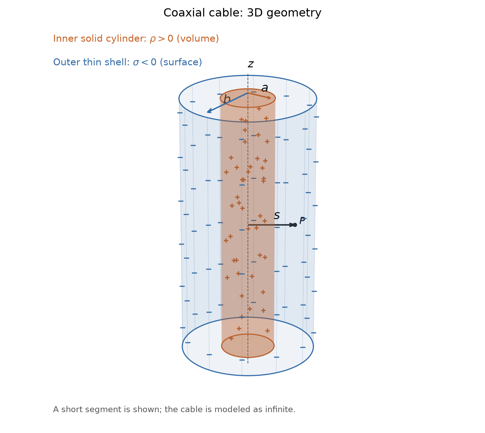
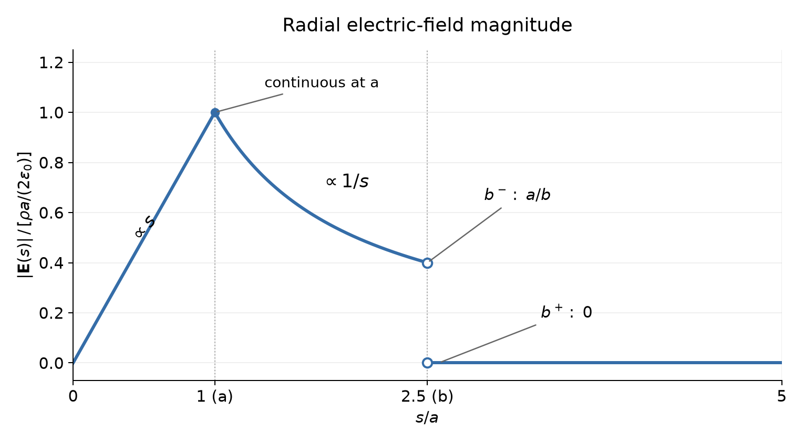

## Questions
An ideal long coaxial cable has an inner solid cylinder of radius $a$ with uniform positive volume charge density $\rho$, and a thin concentric outer cylindrical shell of radius $b>a$. The outer shell has a uniform negative surface charge density chosen so that the total charge per unit length of the cable is zero. There is no other charge; neglect end effects. Let $s$ denote distance from the common axis.
1. Determine the required outer surface charge density and the electric field in the three regions $s<a$, $a<s<b$, and $s>b$.
2. Plot $|\mathbf E(s)|$. Indicate the behavior on each side of $s=a$ and $s=b$.
### 1. Charge balance and three-region field
- **Interior ($0\leqslant r<a$):** We use coaxial cylinder surface as Gauss surface$$\oint_{\partial C_r(\mathbf{x_0})}\mathbf{E}\cdot d\,\mathbf{a}=\frac{Q_{enc}}{\epsilon_0}=\frac{1}{\epsilon_0}\int_{C_r(\mathbf{x_0})}\rho \cdot d\,\tau\Rightarrow \mathbf{E}=\frac{\rho r}{2\epsilon_0}\hat{\mathbf{r}}$$
- **In Between ($a<r<b$):** $$\mathbf{E}=\frac{\rho a^2}{2\epsilon_0r}\hat{\mathbf{r}}$$
- **Exterior ($b<r$):** For coaxial cylinder surface containing the cable, $Q_{enc}=0$, thus for the exterior case the magnitude of field is $0$.$$\mathbf{E}=\mathbf{0}$$Additionally we know that $\displaystyle \int_{C_a{\mathbf{(x_0)}}}\rho\cdot d\,\tau=-\displaystyle \int_{\partial C_b{\mathbf{(x_0)}}}\sigma\cdot d\,S,\quad\text{(It's negative charges for the exterior surface.)}$ and the charge density $\rho$ and $\sigma$ is uniform, we could infer that$$\sigma=-\frac{\rho a^2}{2b}$$
### 2. Magnitude plot

We can draw the magnitude above by using the code below:
```python
import numpy as np
import matplotlib.pyplot as plt

a = 0.01
b = 0.025
rho = 1.0e-6
epsilon_0 = 8.854e-12

s_inner = np.linspace(0, a, 300)
s_gap = np.linspace(a, b, 300)
s_outer = np.linspace(b, 2 * b, 300)

e_inner = rho * s_inner / (2 * epsilon_0)
e_gap = rho * a**2 / (2 * epsilon_0 * s_gap)
e_outer = np.zeros_like(s_outer)

fig, ax = plt.subplots(figsize=(8, 5))

ax.plot(s_inner, e_inner, color="C0", linewidth=2)
ax.plot(s_gap, e_gap, color="C0", linewidth=2)
ax.plot(s_outer, e_outer, color="C0", linewidth=2)

ax.axvline(a, color="gray", linestyle="--", label=r"$s=a$")
ax.axvline(b, color="black", linestyle="--", label=r"$s=b$")

ax.plot(a, rho * a / (2 * epsilon_0), "o", color="C0")
ax.plot(
    [b, b],
    [rho * a**2 / (2 * epsilon_0 * b), 0],
    "o",
    markerfacecolor="white",
    markeredgecolor="C0",
    markersize=7,
    zorder=5,
)

ax.set_xlabel(r"$s\;(\mathrm{m})$")
ax.set_ylabel(r"$|\mathbf{E}(s)|\;(\mathrm{N/C})$")
ax.set_xlim(0, 2 * b)
ax.grid(alpha=0.3)
ax.legend()

fig.tight_layout()
plt.show()
```
Below is the running result of the code, there's still sudden mutations obviously. Further more, we can build a class representing all 2-dimensional or 3-dimensional field object having two methods: `draw_magnitude` and `draw_field` as a visualization API, which sounds interesting.
## Energy Stored in Coaxial Cable
> The exterior field can vanish while the cable stores energy. What potential difference exists between its axis and its outer shell? (This connects to Problem 2.24.)

We choose the outer shell as the zero of potential, $V(b)=0$. Since the electric field vanishes outside the cable, the potential is also zero throughout the exterior region. The potential difference between the two cylindrical surfaces is$$ \begin{aligned} V(a)-V(b) &=-\int_b^a E_s(s')\,ds'\\ &=-\frac{\rho a^2}{2\epsilon_0}\int_b^a\frac{ds'}{s'}\\ &=\frac{\rho a^2}{2\epsilon_0}\ln\frac ba. \end{aligned}$$To obtain the potential difference between the axis and the outer shell, we must also include the potential change inside the inner cylinder:$$\begin{aligned} V(0)-V(b) &=\bigl[V(0)-V(a)\bigr]+\bigl[V(a)-V(b)\bigr]\\ &=\int_0^a\frac{\rho s'}{2\epsilon_0}\,ds' +\frac{\rho a^2}{2\epsilon_0}\ln\frac ba\\ &=\boxed{\frac{\rho a^2}{4\epsilon_0} +\frac{\rho a^2}{2\epsilon_0}\ln\frac ba}. \end{aligned}$$
## Source
Griffiths, *Introduction to Electrodynamics*, 4th edition (2013), Problem 2.16, printed p. 76 (PDF p. 95). Faithful paraphrase of the original tasks; any extension is marked optional.