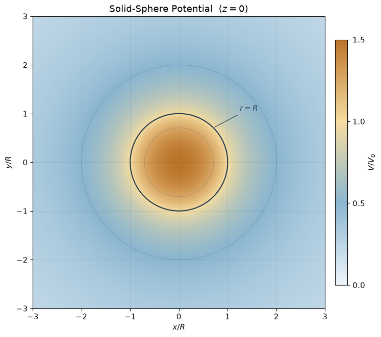

> For some reason, this question wasn't appealing for me. :(
## Question
A solid sphere of radius $R$, centered at the origin, contains total charge $q$ distributed uniformly through its volume. Set $V(\infty)=0$, and let $r$ be distance from its center.
1. **Problem 2.21 - From the electric field.** Determine $V(r)$ both inside and outside the sphere. Calculate the gradient in each region and verify the electric field. Sketch $V(r)$, with one consistent reference for the two regions.
2. **Problem 2.28 - Directly from the source.** Independently calculate the potential for $r<R$ using Eq. 2.29, without obtaining it by integrating the already-known field:$$V(\mathbf r)=\frac{1}{4\pi\epsilon_0}\int_{|\mathbf r'|\leq R}\frac{\rho\,d\tau'}{|\mathbf r-\mathbf r'|},\qquad \rho=\frac{3q}{4\pi R^3}.$$Compare this result with Problem 2.21. The integration variable $\mathbf r'$ is a source point, whereas $\mathbf r$ is fixed during integration.
### 1. From the Field (2.21)
From the field calculation side, we've already got the field expression from the previous discussions. Now we can easily calculate it using Gauss' law.$$\oint_{\partial B}\mathbf E\cdot d\,\mathbf a=\frac{Q_{enc}}{\epsilon_0}$$Then we can have the field outside and inside:
- **Outside ($r>R$)**: $$\mathbf E=\frac{q}{4\pi\epsilon_0r^2}\hat{\mathbf r}$$
- **Inside ($r<R$)**: $$\mathbf E=\frac{qr}{4\pi\epsilon_0R^3}\hat{\mathbf r}$$
Thus the potential could be calculated using $\displaystyle \mathbf E=-\nabla V$. $$\begin{align*}\text{Original}:\quad V(r)&=-\int_\infty^r E_r(s)\,ds\\r>R:\quad V(r)&=-\frac{q}{4\pi\epsilon_0}\int_\infty^r\frac{ds}{s^2} =\frac{q}{4\pi\epsilon_0r}\\r<R:\quad V(r) &=-\int_\infty^R E_{\mathrm{out}}(s)\,ds -\int_R^r E_{\mathrm{in}}(s)\,ds\\ &=\underbrace{\frac{q}{4\pi\epsilon_0R}}_{V(R)} -\frac{q}{4\pi\epsilon_0R^3}\int_R^r s\,ds\\&=V(R)-\frac{q(r^2-R^2)}{8\pi\epsilon_0R^3}\end{align*}$$
### 2. From the Source (2.28)
The uniform volume charge density is
$$
\rho=\frac{3q}{4\pi R^3}.
$$
With the reference $V(\infty)=0$, the potential is
$$V(\mathbf r)
=\frac{1}{4\pi\epsilon_0}
\int_{|\mathbf r'|\leq R}
\frac{\rho\,d\tau'}{|\mathbf r-\mathbf r'|}$$
Here $\mathbf r$ is the fixed observation point, while $\mathbf r'$ is the source point over which we integrate. For $0<r<R$, choose the polar axis along $\mathbf r$. Let $\theta'$ be the angle between $\mathbf r$ and $\mathbf r'$. Then
$$
|\mathbf r-\mathbf r'|
=\sqrt{r^2+r'^2-2rr'\cos\theta'},
\qquad
d\tau'=r'^2\sin\theta'\,dr'\,d\theta'\,d\phi'.
$$
The integrand is independent of $\phi'$, so
$$
V(r)
=\frac{\rho}{2\epsilon_0}
\int_0^R r'^2
\left[
\int_0^\pi
\frac{\sin\theta'\,d\theta'}
{\sqrt{r^2+r'^2-2rr'\cos\theta'}}
\right]dr'.
$$
First evaluate the angular integral. For $r'>0$,
$$
\begin{aligned}
I(r,r')
&=\int_0^\pi
\frac{\sin\theta'\,d\theta'}
{\sqrt{r^2+r'^2-2rr'\cos\theta'}}\\
&=\frac{1}{rr'}
\left[
\sqrt{r^2+r'^2-2rr'\cos\theta'}
\right]_0^\pi\\
&=\frac{r+r'-|r-r'|}{rr'}.
\end{aligned}
$$
The absolute value requires us to distinguish two radial intervals:
$$
I(r,r')
=
\begin{cases}
\displaystyle \frac{2}{r}, & r'<r,\\[6pt]
\displaystyle \frac{2}{r'}, & r'>r.
\end{cases}
$$
The value at $r'=0$ is understood by continuity;
the two expressions agree at $r'=r$.
Therefore,$$
\begin{aligned}
V(r)
&=\frac{\rho}{2\epsilon_0}
\left[
\frac{2}{r}\int_0^r r'^2\,dr'
+2\int_r^R r'\,dr'
\right]\\
&=\frac{\rho}{\epsilon_0}
\left[
\frac{r^2}{3}+\frac{R^2-r^2}{2}
\right]\\
&=\frac{\rho}{6\epsilon_0}(3R^2-r^2).
\end{aligned}
$$Substituting $\rho=3q/(4\pi R^3)$ gives
$$
{
V(r)=\frac{q}{8\pi\epsilon_0R}
\left(3-\frac{r^2}{R^2}\right),
\qquad 0\leq r<R.
}
$$
At the center, the same result follows directly without choosing a polar axis:
$$
V(0)
=\frac{\rho}{4\pi\epsilon_0}
\int_0^R\frac{4\pi r'^2}{r'}\,dr'
=\frac{\rho R^2}{2\epsilon_0}
=\frac{3q}{8\pi\epsilon_0R}.
$$
This agrees with Problem 2.21, using the same reference $V(\infty)=0$. At the surface,
$$
V(R)=\frac{q}{4\pi\epsilon_0R},
$$

which matches the exterior potential.
### Why Split at $r'=r$?
For a source point at radius $r'$, the distance to the observation point ranges from $|r-r'|$ to $r+r'$ as its angular position changes. The minimum distance is $r-r'$ when $r'<r$, but $r'-r$ when $r'>r$. This geometric distinction produces the absolute value in the angular integral and the two radial expressions.
### Boundary & Visualization

We can use the [script](../scripts/Examples/sphere_potential_heatmap.py) in Jupyter with the code below to get visualization graph:
```python
from sphere_potential_heatmap import *

fig, ax = visualize_sphere_potential(
    radius=1.0,
    charge=1.0,
    extent=3.0,
    style={"figsize": (7.5, 6.5)},
)

plt.show()
```
From the graph, you may notice that there's no obvious mutation at the boundary, and we can have the same result calculating the limit$$\lim_{r\to R^-}V=\lim_{r\to R^+}V=\frac{q}{4\pi\epsilon_0R}$$In a conclusion: **Electric field and potential is continuous at the boundary of the uniformly charged solid sphere.**
## Source
Griffiths, *Introduction to Electrodynamics*, 4th edition (2013), Problem 2.21, printed p. 83 (PDF p. 102); Problem 2.28, printed p. 88 (PDF p. 107). Faithful paraphrase of the original tasks; any extension is marked optional.
