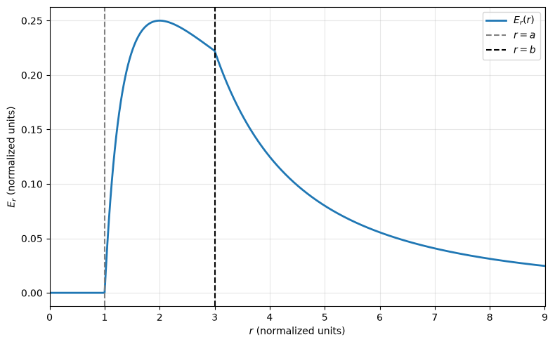

## Questions

A spherical layer occupies $a\leq r\leq b$, where $0<a<b$, and its volume charge density is

$$\rho(r)=\frac{k}{r^2}\quad(a\leq r\leq b).$$

The hollow center and the space outside the layer contain no charge. Here $r$ is distance from the common center, and $k$ is a constant of either sign; use $|k|$ to set the magnitude-plot scale.

1. Determine the electric field in all three regions: $r<a$, $a<r<b$, and $r>b$.
2. For $b=2a$, plot $|\mathbf E(r)|$ across the three regions, keeping the boundary values consistent.
### 1. Three-region field
- **Interior ($0\leqslant r<a$):** We can use Gauss' law like the spherical surface case similarly, It's quite easy to infer that $\mathbf{E}=\mathbf{0}$ using the symmetric properties of the thick spherical shell.
- **Shell ($a<r<b$):** For this highly symmetric case we use Gauss' law $$\oint_{\partial B_r(\mathbf{x}_0)}\mathbf{E}\cdot d\,\mathbf{a}=\frac{Q_{enc}}{\epsilon_0},\,\,a<r<b$$we transfer the equation into$$4\pi r^2E=\frac{1}{\epsilon_0}\int_{B_r(\mathbf{x}_0)}\rho(r')\cdot d\,\tau=\frac{1}{\epsilon_0}\int_a^r\int_0^\pi\int_0^{2\pi}\frac{k}{r'^2}r'^2\sin\theta \cdot d\phi\, d\theta\,dr'$$Thus we get $$\mathbf{E}=\frac{k(r-a)}{\epsilon_0r^2}\cdot\hat{\mathbf{r}}$$
- **Exterior ($b<r$):** We can directly have the answer using Gauss' law.$$\mathbf{E}=\frac{k(b-a)}{\epsilon_0r^2}\cdot\hat{\mathbf{r}}$$
### 2. Magnitude plot: $b = 2a$
The magnitude can be easily inferred as:$$E=\begin{cases}0,\qquad\qquad\,\,\,\,0\leqslant  r<a\\\displaystyle \frac{k(r-a)}{\epsilon_0r^2},\,\quad a<r<b\\\displaystyle \frac{k(b-a)}{\epsilon_0r^2},\,\quad b<r\end{cases}$$Thus we can draw the magnitude curve using `matplotlib` or classic paper & pencil, it should look like this:

You may notice that there's two sudden mutation on the boundary surface, it's a crucial topic, *Boundary Conditions*, that we'll discuss later.
## Source
Griffiths, *Introduction to Electrodynamics*, 4th edition (2013), Problem 2.15, printed p. 76 (PDF p. 95). Faithful paraphrase of the original tasks; any extension is marked optional.
