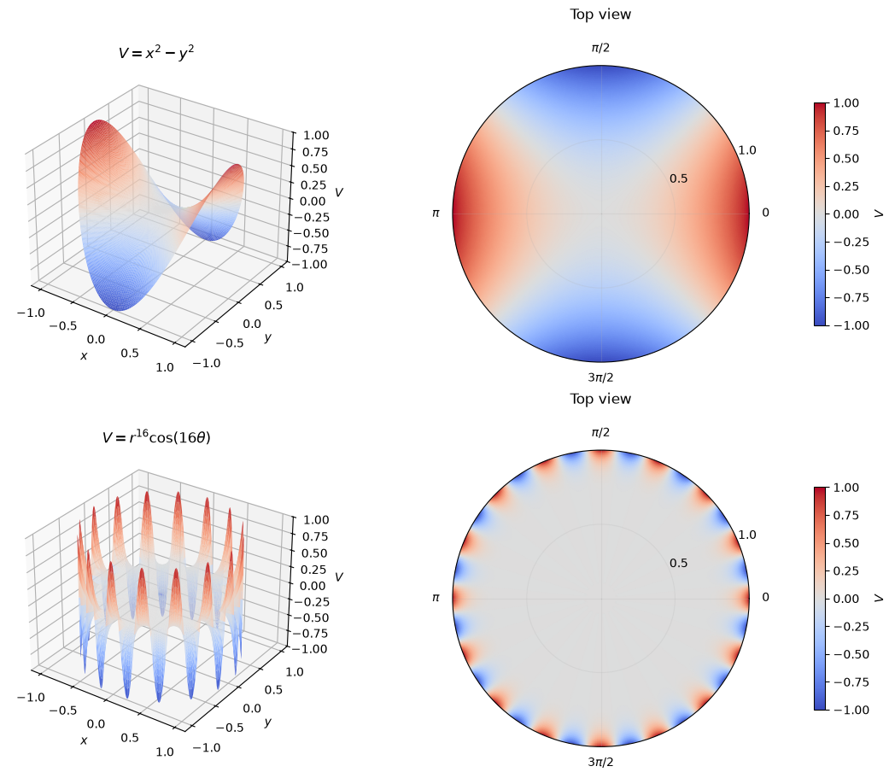
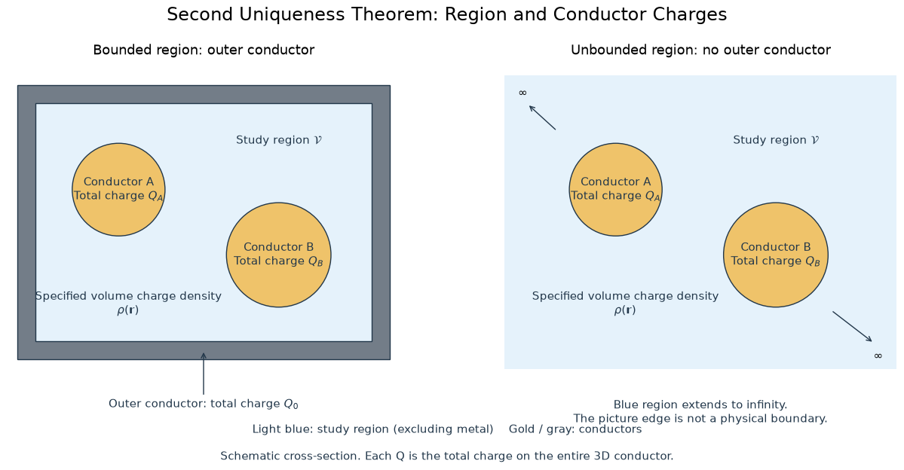

Start from this node post, we're entering a brand new stage of electrodynamics. For this note, we're discussing some interesting visualizations and summary on the topic.
## Solutions to Laplace's Equation
> Here we must restate that in electrostatics in vacuum, Laplace’s equation holds wherever $\rho=0$.

One interesting question is: *Can Laplace's equation determine $V$ by itself?* The only information indicated from this is$$\nabla^2V=0\Rightarrow\text{V is a harmonic function.}$$Here we focus on uniqueness: assuming a solution exists, can another solution satisfy the same equation and boundary conditions?
1. **Affine functions are the solutions to 1-dimensional Laplace's equation.** We can infer this quite easily, since $$\frac{d^2}{dx^2}V(x)=0\Rightarrow V(x)=kx+b$$Specifying $V(x_1)=V_1$ and $V(x_2)=V_2$, with $x_1\ne x_2$, uniquely determines $k$ and $b$.
2. **Laplace’s equation alone does not determine a unique solution.** In three dimensions, it reads$$\frac{\partial^2 V}{\partial x^2}+\frac{\partial^2 V}{\partial y^2}+\frac{\partial^2 V}{\partial z^2}=0$$Many different functions satisfy this equation unless additional conditions are imposed. 
3. **The uniqueness can be ensured by the boundary values.** And this is why I'm writing this note.
## Visualizations
For n-dimensional cases, we can construct numerous harmonic functions, here are some 2-dimensional examples:

```python
from boundary_conditions_and_uniqueness_theorem import *

points = np.array([
    [0.0, 0.0],
    [1.0, 0.0],
    [0.0, 1.0],
    [1.0, 1.0],
    [-1.5, 0.5],
])
examine_functions = [
    (saddle, r"$V=x^2-y^2$"),
    (non_harmonic_saddle, r"$V=x^2-2y^2$"),
    (crown, r"$V=r^{16}\cos(16\theta)$"),
]
visualize_functions = [
    (saddle, r"$V=x^2-y^2$"),
    (crown, r"$V=r^{16}\cos(16\theta)$"),
]

for func, _ in examine_functions:
    examine(func, points)

fig = visualize(visualize_functions)
```

The plots show two analytically defined harmonic functions. Central finite differences provide numerical checks of their Laplacians at selected points, rather than a proof of harmonicity. A non-harmonic saddle is included for comparison ([The script](../scripts/Nodes/boundary_conditions_and_uniqueness_theorem.py)).
## Uniqueness Theorems
In addition, suitable boundary conditions are needed. Then we could have the uniqueness theorems.
1. **The First Uniqueness Theorem**: The solution to Laplace’s equation in some volume $\mathcal{V}$ is uniquely determined if ${V}$ is specified on the boundary surface $\mathcal{S}$.
2. **The Second Uniqueness Theorem**: In a volume $\mathcal{V}$ surrounded by conductors and containing a specified charge density $\rho$, the electric field is uniquely determined if the total charge on each conductor is given (The region as a whole can be bounded by another conductor, or else unbounded).
3. **The Corollary of The First Uniqueness Theorem**: The potential in a volume $\mathcal{V}$ is uniquely determined if
	1. (a) the charge density throughout the region
	2. (b) the value of V on all boundaries, are specified.
## Boundary Conditions
Here we're answering a critical question for understanding, and we'll answer this by figuring out its *input* and its *output*: 

> *How do we define needed boundary conditions?*

For the first uniqueness theorem, we need to know:
- **Boundary condition:** Potential V is specified on the boundary surface $\partial \mathcal{V}$
- **Prerequisite:** No charges in volume $\mathcal V$
Then we can infer:
- **The uniqueness of the solution to Laplace's equation.**

For the second uniqueness theorem, we need to know:
- **Boundary condition:** Every conductor's total charge is given, $Q_1,Q_2,\cdots,Q_n$
- **Prerequisite:** In the region $\mathcal{V}$, its charge density $\rho(\mathbf{x})$ is known.
Then we can infer:
- **The uniqueness of electric field $\mathbf{E}$.**

Here is a graph to help understanding:

For the second uniqueness theorem, our region can be finite in a conductor box, or it can be infinite.

Notice that each conductor is in electrostatic equilibrium and is therefore an equipotential, although its potential is not prescribed. The electric field is unique; in a connected study region, the potential is determined up to an additive constant unless a reference is fixed.

For an unbounded region, the behavior at infinity must also be specified. For an isolated system with a finite, localized charge distribution, we commonly require $V\to0$ as $|\mathbf r|\to\infty$.

These two cases distinguish a bounded region enclosed by an outer conductor from an unbounded exterior region. They do not imply that the potential is constant throughout the study region.

---

The method of images makes me wonder how inversion and, in two dimensions, complex analysis can help construct solutions. I will leave this connection for later exploration.