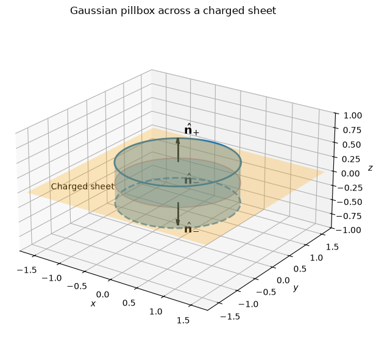
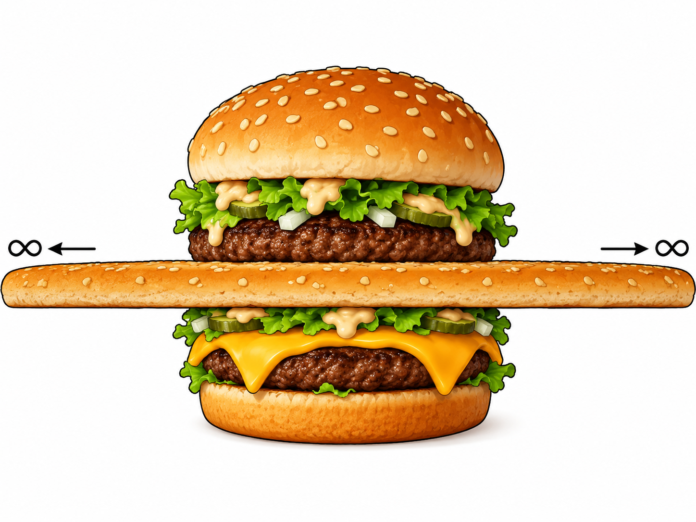

## Boundary Conditions
### Gaussian Pillbox
From our previous discussions on the examples of neutral spherical surface, thick spherical shell and coaxial cable, electric field always undergoes a discontinuity when you cross a surface charge $\sigma$. We call this phenomenon *boundary conditions*.
Imagine boundaries, it's easy to think of an infinite plane that divide the space into halves. Here we're introducing the concept of Gaussian pillbox.

We choose an area on the plane and use Gauss' law and calculate its flux, notice that the $\mathbf{E}$ below the surface is pointing the opposite direction with its direction above, since the tangential component of electric field is $0$, we have that $\displaystyle \oint_{\partial G}\mathbf{E}\cdot d\,\mathbf{a}=A(\mathbf{E^{\perp}_{above}}-\mathbf{E^{\perp}_{below}})$, then we have the relation between flux and the surface charge $\sigma$:$$\oint_{\partial G}\mathbf{E}\cdot d\,\mathbf{a}=2|\mathbf{E}|A=\frac{Q_{enc}}{\epsilon_0}=\frac{\sigma A}{\epsilon_0}$$Then we have that$$\mathbf{E^{\perp}_{above}}-\mathbf{E^{\perp}_{below}}=\frac{\sigma}{\epsilon_0}\hat{\mathbf{n}}$$For consistency, we let "upward" be the positive direction for both, then we come to a conclusion that the normal component of $\mathbf{E}$ is discontinuous by an amount $\displaystyle \frac{\sigma}{\epsilon_0}$ at any boundary. But for the tangential component and cases that the surface contains no charges, the field is continuous, we can calculate and have this result by integrating a loop across the surface.

And the Gaussian pillbox is like a big mac hamburger, but the bread in the middle is infinite (generated picture, just for fun:).

We can get the visualization above using this code in Jupyter:

```python
import numpy as np
import matplotlib.pyplot as plt

radius = 1.0
half_height = 0.35

fig = plt.figure(figsize=(8, 6))
ax = fig.add_subplot(projection="3d")

x_sheet, y_sheet = np.meshgrid([-1.7, 1.7], [-1.7, 1.7])
ax.plot_surface(
    x_sheet, y_sheet, np.zeros_like(x_sheet),
    color="orange", alpha=0.25, shade=False,
)
ax.text(1.5, -5, 2, r"Charged sheet")
phi = np.linspace(0, 2 * np.pi, 100)
phi_side, z_side = np.meshgrid(phi, [-half_height, half_height])
ax.plot_surface(
    radius * np.cos(phi_side),
    radius * np.sin(phi_side),
    z_side,
    color="tab:blue", alpha=0.18, shade=False
)

r_cap, phi_cap = np.meshgrid(np.linspace(0, radius, 25), phi)
x_cap = r_cap * np.cos(phi_cap)
y_cap = r_cap * np.sin(phi_cap)

for sign in (-1, 0, 1):
    z_cap = sign * half_height
    ax.plot_surface(
        x_cap, y_cap, np.full_like(x_cap, z_cap),
        color="tab:blue", alpha=0.25, shade=False,
    )
    if sign == 1:
        ax.plot(
            radius * np.cos(phi),
            radius * np.sin(phi),
            np.full_like(phi, z_cap),
            color="tab:blue", linewidth=2,
        )
    elif sign == 0:
        ax.plot(
            radius * np.cos(phi),
            radius * np.sin(phi),
            np.full_like(phi, z_cap),
            color="tab:red", linewidth=1.5,
            alpha=0.3
        )
    else:
        ax.plot(
            radius * np.cos(phi),
            radius * np.sin(phi),
            np.full_like(phi, z_cap),
            color="tab:blue", linewidth=2,
            linestyle='--', alpha=0.7
        )
    ax.quiver(
        0, 0, z_cap, 0, 0, sign * 0.4,
        color="black", arrow_length_ratio=0.25, linewidth=2,
    )
    label = (
        r"$\hat{\mathbf{n}}_{+}$"
        if sign == 1
        else r"$\hat{\mathbf{n}}_{-}$"
    )
    ax.text(0.12, 0, z_cap + sign * 0.5, label, fontsize=14)

ax.set_xlabel(r"$x$")
ax.set_ylabel(r"$y$")
ax.set_zlabel(r"$z$")
ax.set_title("Gaussian pillbox across a charged sheet")
ax.set_xlim(-1.8, 1.8)
ax.set_ylim(-1.8, 1.8)
ax.set_zlim(-1, 1)
ax.set_box_aspect((3.6, 3.6, 2))
ax.view_init(elev=23, azim=-55)
plt.tight_layout()
plt.show()
```
### Potential
The potential is continuous across any boundary, since$$V_{above}-V_{below}=-\int_{\mathbf{a}}^\mathbf{b}\mathbf{E}\cdot d\,\mathbf{l}$$The integral shrinks to zero as the path length shrinks:$$V_{above}=V_{below}$$Thus we have that $\displaystyle \nabla V_{above}-\nabla V_{below}=-\frac{\sigma}{\epsilon_0}\hat{\mathbf{n}}$. We note this as$$\displaystyle \frac{\partial}{\partial n} V_{above}-\frac{\partial}{\partial n} V_{below}=-\frac{\sigma}{\epsilon_0},\,\text{Where }\,\frac{\partial}{\partial n}V=\nabla V\cdot \hat{\mathbf{n}}$$