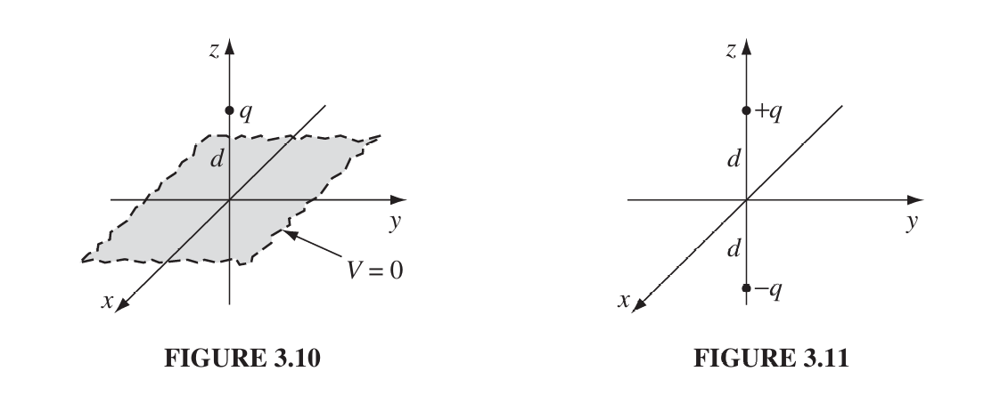
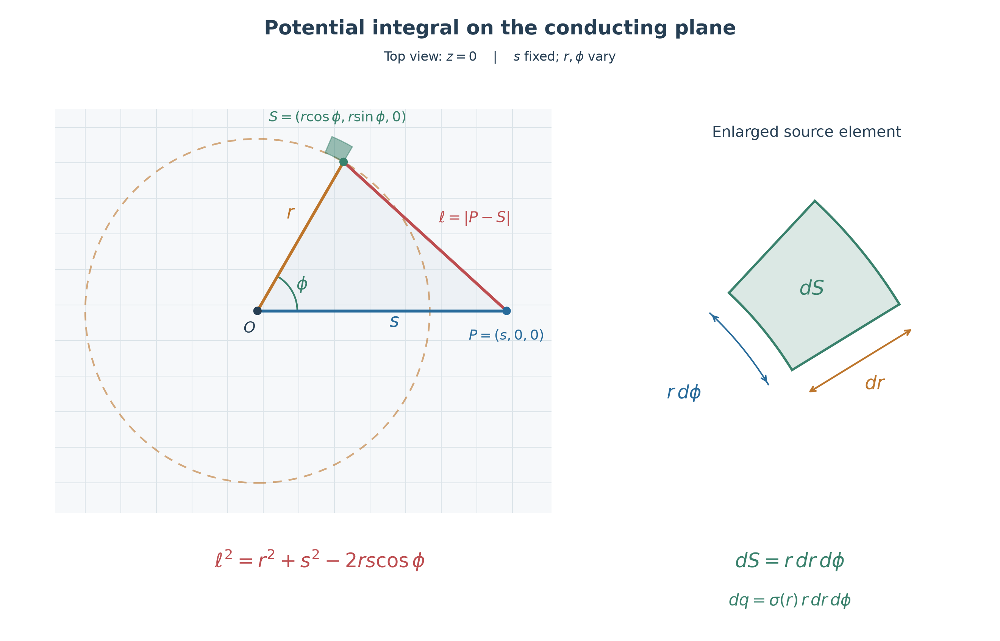
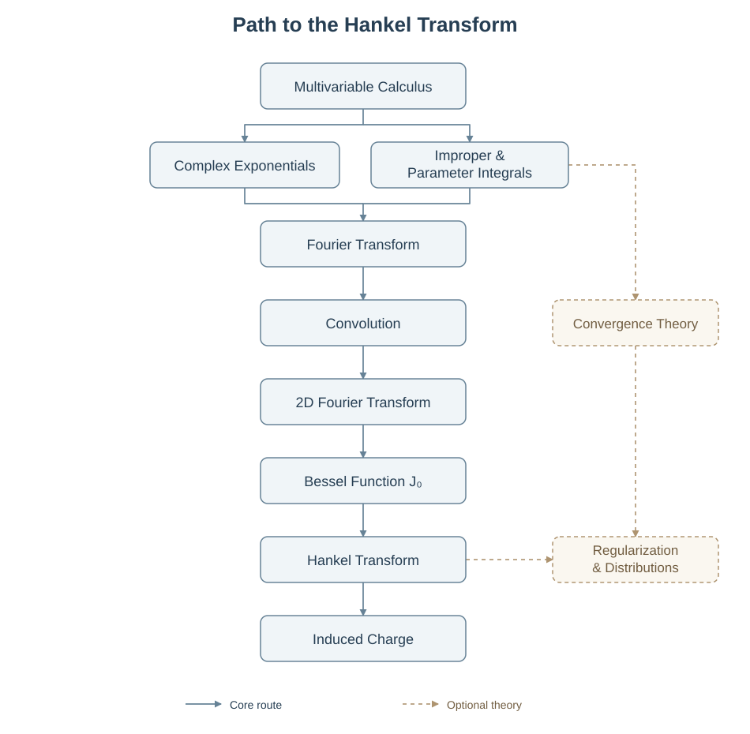
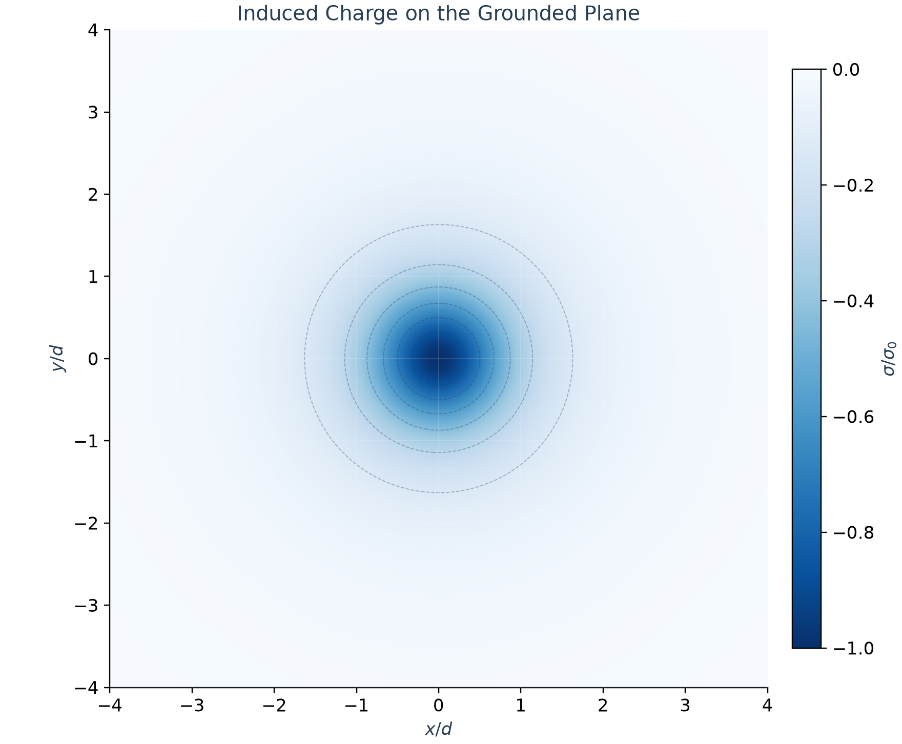

> **From this note we'll learn:**
> 1. *How hard it can be without the method of images.*
> 2. *Uniqueness theorem ensures its correctness.*
> 3. *It's more a kind of art than a method actually.*
## Two Situations
Here we're considering two completely different situations, but they have something in common, partly.

1. Suppose a point charge $q$ is held a distance $d$ above an infinite grounded conducting plane (Fig. 3.10).
2. Suppose two point charges, $+q$ at $(0, 0, d)$ and $−q$ at $(0, 0, −d)$, and no conducting plane (Fig. 3.11).
Question: What is the potential in the region above the x-y plane?
## The Conducting Plane Case
As we know that the potential obeys the superposition principle, and the goal is attack the conducting plane case from the front. We can calculate the induced potential and the charge potential separately, then do the summation.
Thus we have:$$\begin{align*}V_\text{ind}(s,0,0)&=\frac{1}{4\pi\epsilon_0}\int_0^\infty\int_0^{2\pi}\frac{\sigma(r)\cdot r\,d\phi\, dr}{\sqrt{r^2+s^2-2rs\cos\phi}}\\V_\text{q}&=\frac{q}{4\pi\epsilon_0\sqrt{s^2+d^2}}\\V_\text{ind}+V_q&=0\end{align*}$$Notice that the induced potential is using polar coordinates, and here is the visual demonstration for the potential integral:

From the figure you can easily recognize the surface area element $dS=r\,d\phi\,dr$ and why we're using laws of cosine. Now Back to the integral equation:$$\int_0^\infty\int_0^{2\pi}\frac{\sigma(r)\cdot r\,d\phi\, dr}{\sqrt{r^2+s^2-2rs\cos\phi}}=-\frac{q}{4\pi\epsilon_0\sqrt{s^2+d^2}}$$And **$\sigma(r)$ is unknown**, what we're really dealing with is a integral equation. It's necessary to note that **$\displaystyle \int_0^{2\pi}\int_{0}^{\infty}\sigma(r)r\cdot dr\,d\phi=-{q}$ is not a known condition**, since we have no clue to calculate that even it's intuitive (the plane is infinite).

Then GPT told me that I can use [*Hankel transform*](https://mathworld.wolfram.com/HankelTransform.html) to solve this, since I have no idea how to solve this, here is the solution, and one possible study route from vector calculus to *Hankel transform*:$$\sigma(r)=-\frac{qd}{2\pi(r^2+d^2)^{3/2}},\quad\int_{S}\sigma\cdot dS=q$$

Now we can find the solution to the potential for every point above the x-y plane by integrating one more time. The answer is$$V(s,z)=\frac{q}{4\pi\epsilon_0} \left[ \frac1{\sqrt{s^2+(z-d)^2}} - \frac1{\sqrt{s^2+(z+d)^2}} \right]$$
> *The process is quite tricky, I didn't understand it fully, so I'm skipping it for now.*

## The Dipole Case
Now finally we come to this enjoyable part, dipole is a very elegant model and trivial for calculation. We're just posting the calculation and the answer:$$\begin{align*}V&=\frac{1}{4\pi\epsilon_0}\bigl[\frac q{\sqrt{s^2+(z-d)^2}} - \frac q{\sqrt{s^2+(z+d)^2}}\bigr]\\&=\frac{q}{4\pi\epsilon_0} \left[ \frac1{\sqrt{s^2+(z-d)^2}} - \frac1{\sqrt{s^2+(z+d)^2}} \right]\end{align*}$$The same with the above calculation we struggling with.
## Visualize $\sigma(r)$

Since heatmap is usually the way I visualize densities or potential, why not just use a single [heatmap script](../scripts/Nodes/heatmap.py) instead of repeating a piece of code all the time. We implement it by the cell below.
```python
from heatmap import *

def surface_charge(u, v):
    """Normalized surface density sigma/sigma_0; assumes q > 0."""
    return -(1 + u**2 + v**2)**(-1.5)

fig, ax, mesh = plot_heatmap(
    surface_charge,
    xlim=(-4, 4),
    ylim=(-4, 4),
    resolution=401,
    cmap="Blues_r",
    vlim=(-1, 0),
    contours=6,
    title="Induced Charge on the Grounded Plane",
    xlabel=r"$x/d$",
    ylabel=r"$y/d$",
    colorbar_label=r"$\sigma/\sigma_0$",
)

plt.show()
```
## The Uniqueness Theorem
This isn't happen coincidentally. We found a case that satisfies the boundary conditions and the total charge is given. To be precise, it follows:
1. $V=0$ when $z=0$.
2. $V\to 0$ when $x^2+y^2+z^2\gg d^2$.
3. Satisfies Poisson's equation above x-y plane.
The uniqueness theorem certifies that if it satisfies Poisson’s equation in the region of interest, and assumes the correct value at the boundaries, then it must be right.
## Force & Energy
The attraction force on the charge $+q$ is the same for the two cases. But the total energy of the two cases is not. The dipole case's energy is the two times of the conducting plane case.$$\begin{align*}\text{Original formula: }W&=\frac{\epsilon_0}{2}\int E^2\cdot d\,\tau\\\text{Dipole case: }W&=-\frac{q^2}{8\pi\epsilon_0 d}\\\text{Conducting plane: }W&=-\frac{q^2}{16\pi\epsilon_0 d}\end{align*}$$This is because energy actually stored in the fields, and for the conducting plane, no fields below the x-y plane, then it's half of the dipole case.
## Other Image Problems
There would be more cases to explore in the example nodes, and I believe that using inversive geometry on the complex plane for circles would be interesting.