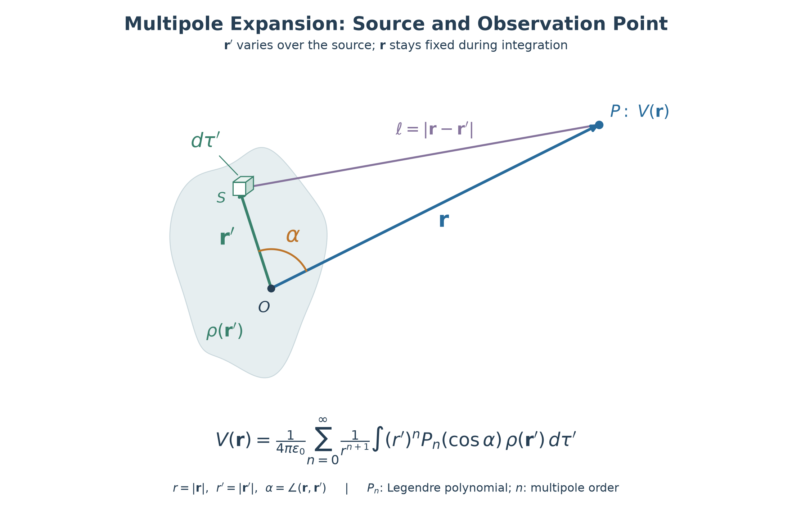
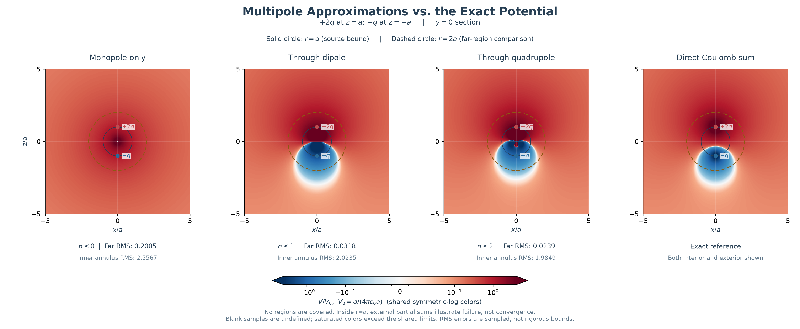
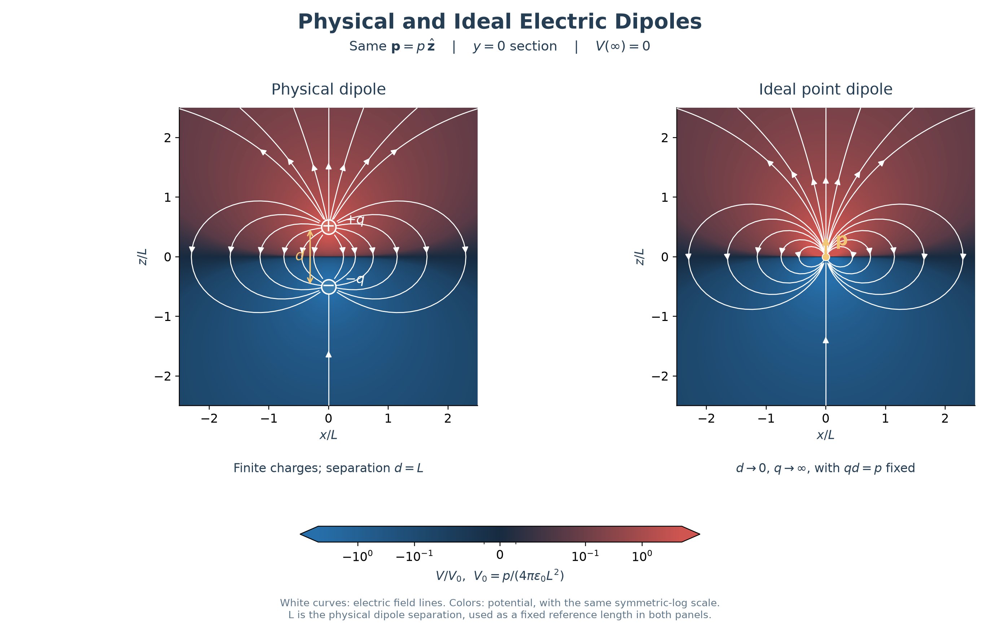

> [!note] **The Key Insights of This Note**
> 1. **Validity:** If all source charges lie within $r'\leq a$, the exterior multipole expansion converges for $r>a$.
> 2. **Approximation:** At large distances, a few source moments often suffice. The required truncation order depends on the observation region and the desired accuracy.
> 3. **Source information:** Multipole moments summarize different aspects of a charge distribution. The lowest nonzero moment determines its leading far-field behavior.
## Expansion: Theoretically & Computationally
Theoretically, we've already expressed the integral of potential for localized charge distribution:$$V(\mathbf r)=\frac{1}{4\pi\epsilon_0}\int\frac{1}{|\mathbf r-\mathbf r'|}\rho(\mathbf{r}')d\tau'$$Ignoring the calculation process (quite complex), we can write down the expansion of the equation above$$V(\mathbf{r})=\frac{1}{4\pi\epsilon_0}\sum_{n=0}^\infty\frac{1}{r^{(n+1)}}\int(r')^nP_n(\cos\alpha)\rho(\mathbf r')\,d\tau'$$Here $r=|\mathbf r|$, $r'=|\mathbf r'|$, and $\alpha$ is the angle between $\mathbf r$ and $\mathbf r'$. $P_n$ is the Legendre polynomial of degree $n$. If all source charges lie within $r'\leq a$, this exterior expansion is exact for $r>a$.

And the expansion above is theoretically exact, but even better, it's useful as as an approximation scheme, which belongs to the computational topic.

Computationally, expansions have the advantage of controlling the accuracy for different cases.
## Experiments: Approximation Accuracy

We use [heatmap](../scripts/Nodes/heatmap.py) and [the demo script](../scripts/Nodes/multipole_convergence.py) to compare three cumulative multipole approximations with the exact Coulomb potential.

Before choosing a truncation order, we specify the observation region. All source charges lie within $r'\leq a$, so the exterior multipole series converges for $r>a$. As we approach this boundary from outside, $a/r$ approaches one, and more terms are generally needed to achieve the same accuracy.

The solid circle marks $r=a$. The dashed circle marks our chosen comparison radius, $r=2a$; neither circle is a physical surface.

We display both the interior and exterior to make the limitations visible. Inside $r=a$, the external partial sums illustrate failure rather than convergence. Adding more terms does not make this exterior expansion valid there.

The heatmaps share the same color scale. Sampled RMS errors are reported separately for $a<r<2a$ and $r\geq2a$. These compare overall accuracy; errors need not decrease monotonically at every point.
## Physical Dipole & Ideal Dipole

> *Dipole is a really meaningful topic for this repo, I was daydreaming in the physical class, then I decided to visualize something fun, then the physical dipole was my first choice.*

The structure of a physical dipole is quite straight forward, a physical electric dipole consists of two equal and opposite point charges, $+q$ and $-q$, separated by a finite distance $d>0$.

An ideal (point) electric dipole is obtained by taking the limit $d\to0$ and $q\to\infty$, while keeping the dipole moment $\mathbf p=q\mathbf d$ fixed. A physical dipole can be approximated by an ideal dipole when the observation distance is much greater than its separation, $r\gg d$.
## Dipole Moment
For a physical dipole, the electric dipole moment is a vector $\displaystyle \mathbf p=q(\mathbf r'_+-\mathbf r'_-)$ pointing the direction from the negative charge to the positive charge. But the dipole moment become informative when it comes to the continuous charge distribution cases.$$\mathbf p\equiv\int\mathbf r'\rho(\mathbf r')\,d\tau'$$Since the textbooks has given the exact definition, I'll note some of my intuitions here:
- **For a neutral distribution, the dipole moment measures the separation between the positive and negative charge distributions.** It captures one aspect of the distribution; a vanishing dipole moment does not imply a vanishing electric field.
- **Multipole moments summarize different aspects of a charge distribution.** The monopole moment is a scalar, the dipole moment is a vector, and higher-order moments can be represented by higher-rank tensors.
- **The dipole moment generally depends on the choice of origin.** For a neutral distribution, $Q=0$, the entire dipole moment vector is independent of the origin.

---

> [!warning] **My Intuitions (Might not be correct.)**
> 1. _The expansion of potential:_ $$V(\mathbf{r})=\frac{1}{4\pi\epsilon_0}\sum_{n=0}^\infty\frac{1}{r^{(n+1)}}\int(r')^nP_n(\cos\alpha)\rho(\mathbf r')\,d\tau'$$
> 2. _Understanding Moment & Approximation:_
>     - Dipole moment is a description of the **overall imbalanced charge distribution**.
>     - Polynomials are easier to calculate for observations at a larger distance.